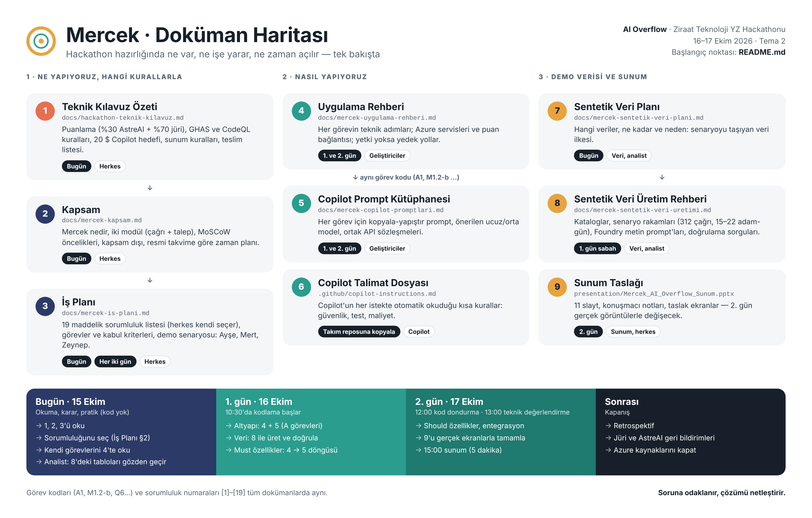

# Mercek — Doküman Rehberi (Buradan Başlayın)

**Takım:** AI Overflow · **Proje:** Mercek · **Slogan:** "Soruna odaklanır, çözümü netleştirir."
**Hackathon:** Ziraat Teknoloji Yapay Zeka Hackathonu, 16–17 Ekim 2026, Tema 2

Bu doküman, hackathon hazırlığında üretilen tüm dokümanları (hepsi bu repoda, `docs/` ve `presentation/` altında) **hangi sırayla, ne zaman ve ne için** kullanacağımızı anlatır. Hepsini baştan sona okumak gerekmiyor; aşağıdaki sırayı izleyin.



---

## 1. Dokümanlar bir bakışta

| # | Doküman | Ne anlatır | Kim için | Nerede |
|---|---|---|---|---|
| 1 | [`docs/hackathon-teknik-kilavuz.md`](docs/hackathon-teknik-kilavuz.md) | Resmi kılavuzun özeti: ortam ve hesaplar, AstreAI puanlaması (%30), jüri kriterleri (%70), sunum kuralları, teslim kontrol listesi | Herkes | Repo, Claude projesi |
| 2 | [`docs/mercek-kapsam.md`](docs/mercek-kapsam.md) | Mercek nedir, iki modül (M1 çağrı, M2 talep), MoSCoW öncelikleri, kapsam dışı, resmi takvime göre zaman planı | Herkes | Repo, Claude projesi |
| 3 | [`docs/mercek-is-plani.md`](docs/mercek-is-plani.md) | Mimari, **19 maddelik sorumluluk listesi** (herkes kendi seçer), görev dökümü ve kabul kriterleri, zaman × odak tablosu, **demo senaryosu** (Ayşe, Mert, Zeynep), iş değeri, soru-cevap | Herkes | Repo, Claude projesi |
| 4 | [`docs/mercek-sentetik-veri-plani.md`](docs/mercek-sentetik-veri-plani.md) | Hangi veriler, ne kadar, neden (senaryo güdümlü veri ilkesi) | Veri sorumluları, analist | Repo, Claude projesi |
| 5 | [`docs/mercek-sentetik-veri-uretimi.md`](docs/mercek-sentetik-veri-uretimi.md) | Verinin **nasıl ve hangi değerlerle** üretileceği: kataloglar, senaryo rakamları, Faker kuralları, Foundry metin prompt'ları, doğrulama sorguları | Veri sorumluları | Repo, Claude projesi |
| 6 | [`docs/mercek-uygulama-rehberi.md`](docs/mercek-uygulama-rehberi.md) | Her görevin **nasıl** yapılacağı: Azure servisleri ve puan bağlantısı, teknoloji seçimi, kimlik doğrulama yedek yolları, görev görev teknik adımlar | Geliştiriciler | Repo, Claude projesi |
| 7 | [`docs/mercek-copilot-promptlari.md`](docs/mercek-copilot-promptlari.md) | Her görev için Copilot'a yapıştırılacak hazır prompt, model sınıfı (ucuz/orta), ortak sözleşmeler (`contracts.md`) | Geliştiriciler | Repo, Claude projesi |
| 8 | [`.github/copilot-instructions.md`](.github/copilot-instructions.md) | Copilot'un her istekte otomatik okuduğu kısa kural dosyası (güvenlik, CodeQL yasağı, test, maliyet) | Copilot | Repo |
| 9 | [`presentation/Mercek_AI_Overflow_Sunum.pptx`](presentation/Mercek_AI_Overflow_Sunum.pptx) | 11 slaytlık sunum taslağı, konuşmacı notları ve taslak ekran görüntüleriyle | Sunum sorumlusu, herkes | Repo |
| 10 | [`presentation/build-deck.js`](presentation/build-deck.js), [`presentation/mockups/`](presentation/mockups) | Sunumu ve taslak ekranları yeniden üreten betik ve HTML kaynağı | Sunum sorumlusu | Repo |
| 11 | [`docs/mercek-takim-anlatim-cumleleri.md`](docs/mercek-takim-anlatim-cumleleri.md) | Her dokümanın ana fikrini tek cümleyle veren takım anlatım özeti ve akılda kalacak rakamlar | Toplantıyı yöneten, herkes | Repo, Claude projesi |

**Dokümanlar arası ilişki**

```
kılavuz (kurallar)
   └─ kapsam (ne yapıyoruz)
        └─ iş planı (kim, ne zaman, demo)
             ├─ uygulama rehberi (nasıl)  ──► Copilot prompt'ları (Copilot'a ne yazılır)
             ├─ veri planı (hangi veri)   ──► veri üretim rehberi (hangi değerlerle)
             └─ sunum taslağı (jüriye nasıl anlatılır)
```

Görev kodları (A1, M1.2-b, Q6 …) ve sorumluluk numaraları ([1]–[19]) tüm dokümanlarda aynıdır. Bir görevi bir dokümanda bulduğunuzda diğerlerinde aynı kodla arayın.

---

## 2. Hackathon öncesi (15 Ekim, bugün)

> Kural: Önceden kod yazılması istenmiyor. Bugün **okuma, tasarım, karar ve pratik** günü.

| Sıra | Ne yapılacak | Doküman | Kim |
|---|---|---|---|
| 1 | Kuralları okuyun; özellikle GHAS (main'e giren bulgu geri alınmaz), CodeQL dosyası yasağı ve 20 $ Copilot hedefi | Kılavuz | Herkes |
| 2 | Kapsamı ve demo senaryosunu okuyun; itiraz veya öneri varsa bugün söyleyin | Kapsam, İş planı §5 | Herkes |
| 3 | **Sorumluluk seçimi:** 19 maddeden herkes 2–4 tane seçsin. 1, 4, 17, 18 boş kalamaz; 5, 16, 17, 18 farklı kişilerde olmalı | İş planı §2 | Herkes |
| 4 | Seçtiğiniz sorumlulukların görevlerini uygulama rehberinde okuyun | Uygulama rehberi | Herkes kendi payına |
| 5 | Katalog ve senaryo tablolarını gerçekçilik açısından gözden geçirin (ekip, servis, hata kodu adları) | Veri üretim rehberi §3–4 | Analist, veri sorumluları |
| 6 | Soru bankası ve alan standartlarını metin olarak hazırlayın | Veri üretim rehberi §8, Prompt'lar M2.3-a | Analist |
| 7 | Foundry metin prompt'larını herhangi bir sohbet aracında 2–3 örnekle deneyin | Veri üretim rehberi §6 | Veri sorumluları |
| 8 | Kişisel hesaplarla **pratik:** React Joyride (React sürüm uyumu), AI Search hibrit arama, GitHub Actions → App Service deploy | Uygulama rehberi §0.2, M1.5-b, A2 | İlgili geliştiriciler |
| 9 | Sunum taslağına göz atın; 3. slayt için kurumdan gerçek bir rakam (aylık transfer çağrısı, ortalama çözüm süresi) bulunabilir mi bakın | Sunum, İş planı §5 iş değeri | Sunum ve iş değeri sorumluları |
| 10 | Hesaplar geldiyse VDI, Azure Portal ve `_ziraathc` GitHub girişlerini deneyin | Kılavuz "Ortam" | Herkes |

---

## 3. Hackathon sırasında

### 1. gün — 16 Ekim Cuma

| Saat | Ne yapılacak | Doküman |
|---|---|---|
| 08:00–10:30 | Kayıt ve açılış (kod yok). Sorumlulukları teyit edin; VDI/Azure/GitHub girişlerini test edin | İş planı §2, Kılavuz |
| 10:30–10:45 | **İlk kararlar:** backend teknolojisi (FastAPI / .NET); hesabın Azure'da rol ataması ve uygulama kaydı yetkisi var mı? (yoksa yedek yol) | Uygulama rehberi §0.2–0.3 |
| 10:30–13:30 | Altyapı: repo iskeleti, `copilot-instructions.md` + kılavuzu repoya koyma, `docs/contracts.md`, CI/CD, Azure kaynakları, sentetik veri | Prompt'lar §1 + A1–A6, A5-0 · Uygulama rehberi A · Veri üretim rehberi §1–7 |
| 13:30 | **Kontrol:** pipeline yeşil, `/health` 200, Foundry modeli yanıt veriyor, veri doğrulama tablosu tutuyor | Veri üretim rehberi §7 |
| 14:30–19:00 | Must maddeleri (M1.1–M1.3, M2.1, M2.4) | İş planı §3 · Uygulama rehberi · Prompt'lar |
| 20:00–gece | M1.4, M2.5, Talep Asistanı, senaryo testleri, ham demo kaydı | Aynı + İş planı Q2 |

### 2. gün — 17 Ekim Cumartesi

| Saat | Ne yapılacak | Doküman |
|---|---|---|
| 09:30–12:00 | Should maddeleri (M1.5 Joyride, M2.3, M2.6), entegrasyon, hata düzeltme | İş planı §3 · Prompt'lar |
| **12:00** | **Kod dondurma:** son pipeline success, Security sekmesi temiz, `/health` 200 | Uygulama rehberi Q6 · Kılavuz kontrol listesi |
| **13:00–14:00** | **Teknik değerlendirme (AstreAI)** — bu saatten önce her şey main'de ve yeşil | Kılavuz |
| 12:00–13:30 | Demo videosu ve gerçek ekran görüntüleri; sunumdaki taslak görselleri değiştirme (resme sağ tık → "Resmi Değiştir") | Sunum · Uygulama rehberi Q7 |
| 13:30–14:45 | Sunumu tamamlama (takım bilgileri, ölçülen süreler, tamamlananlar, bağlantılar) ve iki prova | Sunum notları · İş planı §5 |
| 15:00–17:20 | Sunum (5 dakika) | Sunum konuşmacı notları |

**Gün boyunca sürekli:** Her 2 saatte bir 5 dakikalık durum kontrolü ve Copilot harcama takibi (hedef < 20 $). İş planı Q5, uygulama rehberi §0.4.

### Copilot ile çalışırken

1. Görevin kodunu bulun (ör. M1.2-b).
2. **Uygulama rehberi**nden ne yapılacağını okuyun.
3. **Prompt kütüphanesi**nden aynı kodlu prompt'u kopyalayın, `<...>` yerlerini doldurun.
4. Belirtilen model sınıfını seçin, yeni bir Chat oturumu açın.
5. Diff'i okuyun, testi çalıştırın, PR açın; PR'ı başka biri onaylasın.

---

## 4. Sunum öncesi son kontrol (2. gün 14:30)

- [ ] Kapak ve takım slaytı dolu (ad, birim, rol)
- [ ] Taslak görseller gerçek ekran görüntüleriyle değişti ("TASLAK GÖRSEL" etiketi kalmadı)
- [ ] İş değeri slaytında ölçülen süreler var; varsayımlar açıkça yazıyor
- [ ] Mimari slaytında sadece gerçekten çalışan Azure servisleri var
- [ ] "Tamamlanan" listesi gerçek durumu gösteriyor
- [ ] Ekler slaytında repo, Web App ve video bağlantıları var
- [ ] Hiçbir görselde şifre, anahtar, connection string, e-posta görünmüyor
- [ ] Yedek demo videosu sunum bilgisayarında açık

---

## 5. Hackathon sonrası

| Ne | Doküman |
|---|---|
| Takım retrospektifi: ne işe yaradı, ne yaramadı (kapsam, sorumluluk modeli, Copilot kullanımı, maliyet) | İş planı, Kapsam |
| Jüri ve AstreAI geri bildirimlerinin not edilmesi; "canlıya geçiş" maddelerinin güncellenmesi | Sunum 10. slayt, İş planı soru-cevap |
| Kurum içi devam edilecekse: sentetik verinin gerçek entegrasyon planıyla değiştirilmesi, KVKK değerlendirmesi | Kapsam "kapsam dışı", Sunum 10. slayt |
| Azure kaynaklarının organizasyon talimatına göre kapatılması / bırakılması | Kılavuz |

---

## 6. Hangi dokümanlar takım reposuna kopyalanacak?

Hackathon günü takıma ayrılan repoya:

| Dosya | Hedef konum |
|---|---|
| [`docs/hackathon-teknik-kilavuz.md`](docs/hackathon-teknik-kilavuz.md) | `docs/` |
| [`.github/copilot-instructions.md`](.github/copilot-instructions.md) | `.github/` (dosya adı değişmeden) |
| Prompt kütüphanesi §1 "Ortak sözleşmeler" | `docs/contracts.md` |
| Veri üretim rehberi §3–4 tabloları | `data/seed/catalog.json`, `scenarios.json` (A5-0 prompt'uyla) |
| Veri üretim rehberi §6 prompt'ları | `prompts/gen-*.md` |

Kapsam, iş planı, uygulama rehberi ve prompt kütüphanesi **ürün reposuna konmaz**; takımın çalışma dokümanıdır. Sunum dosyası teslim için ayrıca yüklenir.
